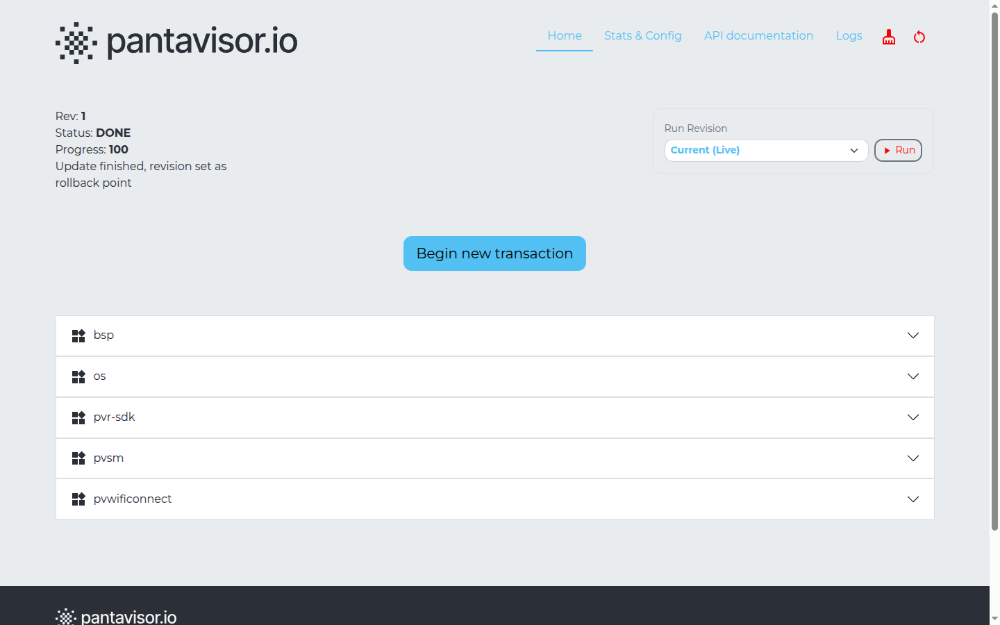
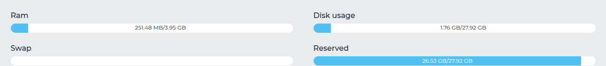
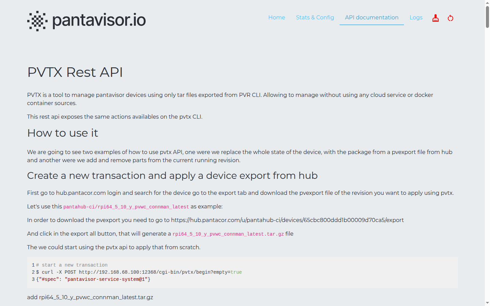
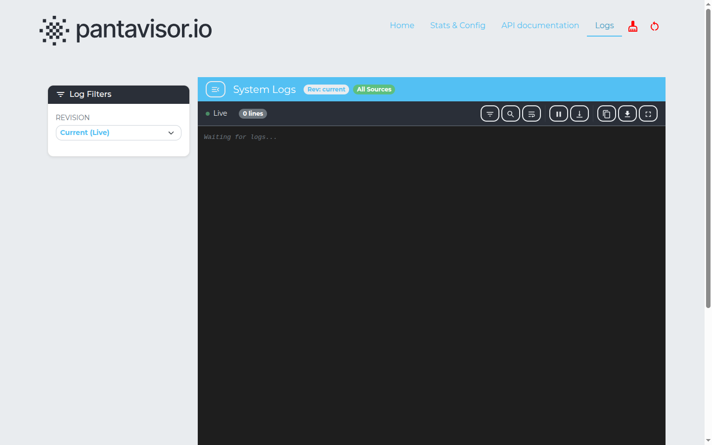

The **pvtx app** is a web interface served directly from the device on port **12368**. It gives you a browser-based view of the device's revisions, containers, resource usage, configuration, the on-device REST API, and live logs — without the `pvr` CLI or SSH.

Open a browser and navigate to:

```
http://<device-ip>:12368/app/
```

The top navigation has four pages: **Home**, **Stats & Config**, **API documentation**, and **Logs**.

---

## Home — revision state and transactions

The **Home** page shows the device's current revision and lets you switch revisions or start a transaction.



Top-left status block:

- **Rev** — the current revision number in the device's [trail](/meta-pantavisor/overview/glossary#trail).
- **Status** — `DONE` means the current revision is committed and stable. Other states (e.g. `TESTING`) appear while a revision is being evaluated.
- **Progress** — completion percentage of the current update or boot sequence.
- A status line such as *"Update finished, revision set as rollback point"*.

**Run Revision** (top-right) — a dropdown to select a revision (`Current (Live)`, `Rev 0`, `Rev 1`, …) and a **Run** button to boot into it.

**Begin new transaction** — starts a staged update you can apply from a `pvexport`/`.tar.gz` package (see [API documentation](#api-documentation--the-pvtx-rest-api) below for the underlying calls).

**Containers** — each component on the device is an expandable row. On a typical image these include `bsp`, `os`, `pvr-sdk`, `pvsm`, and application containers such as `pvwificonnect`.

---

## Stats & Config

The **Stats & Config** page shows live resource usage, device metadata, and the device configuration.

### Device stats



| Field | Description |
|-------|-------------|
| RAM | Used / total memory |
| Swap | Swap space usage |
| Disk usage | Storage partition used / total |
| Reserved | Storage reserved by Pantavisor |

### Device Meta and Device Config

Below the stats are two tables:

- **Device Meta** — read-only, device-reported values: network interfaces (`interfaces.<iface>.ipv4/ipv6`), Pantahub connectivity (`pantahub.claimed`, `pantahub.online`, `pantahub.state`), platform info (`pantavisor.arch`, `pantavisor.dtmodel`, `pantavisor.version`, kernel `uname`), and storage/sysinfo counters. You can also add your own user-metadata key/value entries here.
- **Device Config** — the active Pantavisor configuration keys (for example `creds.host`/`creds.port`, `secureboot.mode`, `wdt.timeout`, `updater.interval`, log and storage paths).

> **⚠️ Warning — Sensitive values**
>
> Device Meta and Device Config include credentials and identifiers (e.g. `creds.id`, `creds.prn`, `creds.secret`, and SSH `authorized_keys`). Treat this page as sensitive and avoid sharing screenshots of it. (That is why only the resource-stats section is shown above.)

---

## API documentation — the pvtx REST API

The **API documentation** page documents the on-device **PVTX REST API** — the same actions available from the `pvtx` CLI (the on-device counterpart to `pvcontrol`, installed on the device itself — not something you run from your workstation), exposed over HTTP so you can manage the device without any cloud service — you upload pvr export packages directly to the device.



It walks through two workflows with runnable `curl` examples:

- **Replace the whole device state** from a `pvexport` package downloaded from Pantahub.
- **Add or remove parts** of the current running revision.

> **⚠️ Warning — this is a state-changing transaction, not a read-only query**
>
> `begin` opens a transaction that later `add`/`commit` calls apply to the
> device — it's not safe to run on a live device without reading the full
> workflow on the **API documentation** page first (in the pvtx web UI
> itself) so you know what `add`/`commit`/`cancel` steps come next and
> what state they leave the device in if interrupted.

For example, starting a fresh transaction:

```bash
curl -X POST "http://<device-ip>:12368/cgi-bin/pvtx/begin?empty=true"
```

---

## Logs

The **Logs** page streams Pantavisor runtime and container logs directly in the browser.



- **Log Filters** (left) — choose the **revision** to view logs for (`Current (Live)` or a specific revision).
- **System Logs** header — shows the selected revision and source scope (e.g. **All Sources**), with a **Live** indicator and line count.
- **Toolbar** (top-right of the log pane) — filter, search, pause/resume the live stream, download, copy, and full-screen.

This view mirrors the on-device log files under `/pantavisor/logs` (configurable via the `log.dir` config key).

---

## pv-ctrl pass-through — `/cgi-bin/pvctrl`

The same web server also forwards a few calls to pv-ctrl, Pantavisor's control socket. `pvr devmode` uses it to work on a device without SSH. A request to `/cgi-bin/pvctrl/<pv-ctrl path>` goes to pv-ctrl on `/pantavisor/pv-ctrl` with its method, query and body unchanged, and the status, `Content-Type` and body of the answer come back unchanged. Bodies are streamed, so file contents of any size and any bytes pass through.

It needs:

- the debug shell on, because the web server only starts then (`PV_DEBUG_SHELL`, on by default);
- devmode allowed with `PV_DEVMODE_ALLOWED=true` in `pantavisor.config` or the OEM config, and a devmode revision running for `exec` and the file calls. Without that, pv-ctrl answers `403` or `409` and the CGI passes the answer on.

This is not authenticated, like the pvtx calls above. The pvr-sdk container ships `/etc/pvr-sdk/config.json` with `"listen": "0.0.0.0"`, so anyone on the device's network can reach it while the debug shell is on:

```bash
curl http://<device-ip>:12368/cgi-bin/pvctrl/devmode
```

To keep it on the device, set `pvrsdk_httpd_listen=127.0.0.1` on the kernel command line (or `httpd.listen` in that file) and open a tunnel from your workstation:

```bash
ssh -L 12368:127.0.0.1:12368 root@<device-ip>
```

Only these calls are forwarded. Anything else answers `404` with `{"Error":"not forwarded"}`, and so does a path with a `..` segment.

| Method | Path | What it does |
|--------|------|--------------|
| `GET`, `POST` | `/devmode` | devmode state; start a devmode revision |
| `GET`, `PUT`, `POST`, `DELETE` | `/devmode/<anything below>` | files and inlay of a container, for example `/devmode/files/<container>/<path>` and `/devmode/containers/<container>` |
| `GET` | `/containers` | state of each container |
| `PUT` | `/containers/<name>` | start, stop or restart a container (`?reboot=1` as for `pvcontrol devmode apply --reboot`) |
| `POST` | `/containers/<name>/exec` | run a command in a running container |
| `GET` | `/config2` | the configuration, including `PV_DEVMODE_ALLOWED` |
| `POST` | `/commands` | only with `"op":"LOCAL_RUN"` or `"op":"REBOOT_DEVICE"` in the body |

Through the tunnel, state of devmode:

```bash
curl http://<device-ip>:12368/cgi-bin/pvctrl/devmode
```

Put a file into the devmode files of a container (`-T` sends the file as it is):

```bash
curl -X PUT -T ./my.conf "http://<device-ip>:12368/cgi-bin/pvctrl/devmode/files/my-container/etc/my.conf?mode=0644&uid=0&gid=0"
```

Run a command in a container (the answer carries `stdout_b64`, `stderr_b64` and `exit_code`):

```bash
curl -X POST -H "Content-Type: application/json" \
  --data '{"argv":["cat","/etc/os-release"],"timeout_s":10}' \
  http://<device-ip>:12368/cgi-bin/pvctrl/containers/my-container/exec
```

The calls and their answers are the ones of `pvcontrol devmode` and `pvcontrol containers`, described in the Pantavisor reference `reference/pantavisor-commands.md`; the pvr-sdk container has the `mgmt` role that pv-ctrl asks for them.

### Logs — `/cgi-bin/logs`

The Logs page and `pvr devmode logs` read log files through `/cgi-bin/logs`, which is not part of the pass-through above. Its query takes:

| Key | Meaning |
|-----|---------|
| `rev` | revision folder below `/pantavisor/logs`, with slashes as they are, for example `devmode/r/0`; `current` (the default) is the committed revision, not a running devmode revision |
| `source` | log file below the revision, comma separated for several, for example `my-container/lxc/console.log`; `pantavisor/pantavisor.log` by default |
| `tail=1`, `n=<lines>` | only the last `n` lines |
| `follow=1` | keep the connection open for new lines (with `tail=1`) |

It answers `text/plain`, `404` when no file matches and `400` when `rev` or `source` contains `..`. The last 50 lines of the console log of a container in the running devmode revision (its name is the `revision` of `GET /cgi-bin/pvctrl/devmode`):

```bash
curl "http://<device-ip>:12368/cgi-bin/logs?rev=devmode/r/0&source=my-container/lxc/console.log&tail=1&n=50"
```
